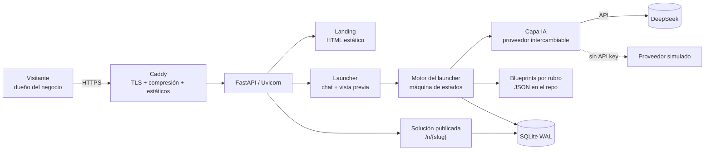
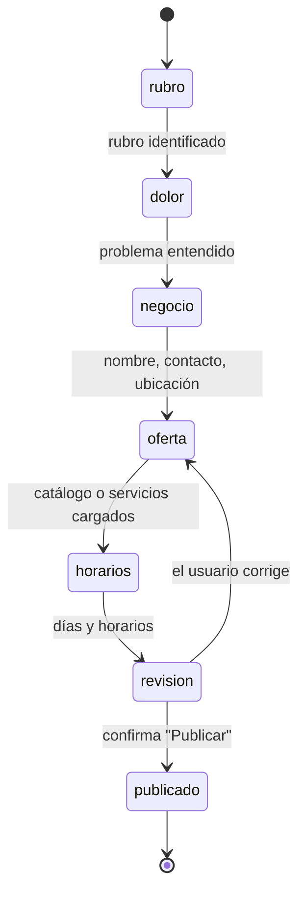
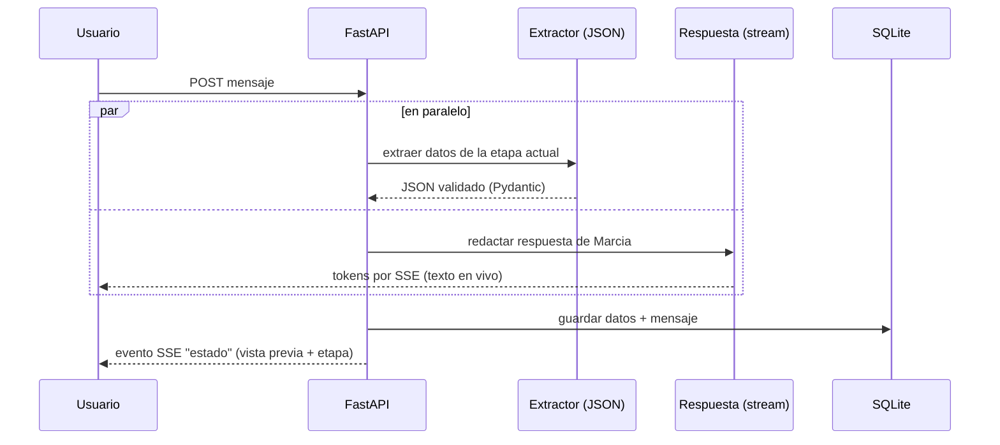
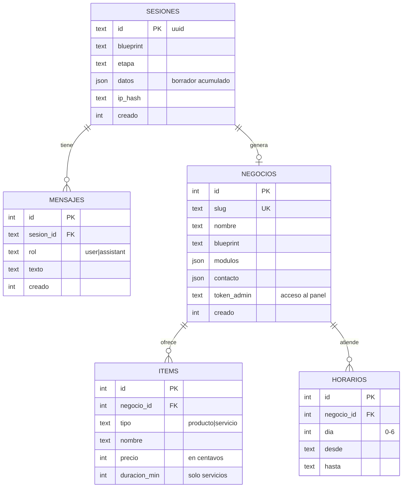

# Arquitectura: Landing + Launcher

> Marcia Neon App: la herramienta para que un negocio local deje de perder pedidos, consultas y turnos que hoy atiende a mano o por WhatsApp.

Este documento cubre la **primera etapa**: la landing pública y el **launcher** (el "creador de soluciones con IA"). Los módulos operativos (pedidos, turnos, panel) se diseñan acá en su forma mínima para que el launcher tenga qué generar, pero se detallan en documentos propios más adelante.

Stack y criterios de optimización: ver [arquitectura.md](arquitectura.md).

---

## 1. Vista general



**Tres piezas visibles para el usuario:**

| Pieza | Ruta | Qué hace |
|---|---|---|
| Landing | `/` | Explica el problema en una línea, muestra el valor y lleva al launcher. El campo "¿Qué rubro sos?" ya inicia la charla. |
| Launcher | `/crear` | Conversación guiada por IA + vista previa en vivo de la solución que se va armando. Termina en "Publicar". |
| Solución publicada | `/n/{slug}` | Mini-sitio del negocio con su asistente, catálogo/pedidos o turnos, según lo que eligió. |

---

## 2. Landing

**Objetivo:** que en 10 segundos el dueño del negocio entienda "esto me resuelve los pedidos perdidos" y empiece a escribir.

- **HTML estático** servido por Caddy (no pasa por Python). Peso objetivo: < 50 KB, sin frameworks.
- **Hero:** *"Decime qué rubro sos y te ayudo a no perder más pedidos."* + un input con chips de rubros (Restaurante, Peluquería, Consultorio, Ferretería, Otro).
- Al enviar el input o tocar un chip → `POST /api/launcher/sesiones` con el rubro y redirección a `/crear?s={id}`. El primer mensaje ya está cargado, así que no hay pantalla vacía.
- **Secciones:** el problema (3 dolores: mensajes perdidos, pedidos mal anotados, clientes que esperan), cómo funciona (3 pasos: contás tu negocio, la IA arma la solución, la publicás), ejemplos (demos de restaurante y peluquería).
- **Sin cookies de terceros ni trackers.**
- **Diseño:** estética *neon* (fondo oscuro, gradiente magenta → violeta → cian, glassmorphism), coherente con el nombre. Hero con un teléfono que muestra una charla animada de Marcia tomando un pedido real y confirmándolo. Secciones: problema + antes/después, cómo funciona, rubros, beneficios, CTA final. Responsive y respeta `prefers-reduced-motion`.
- **Implementado:** `app/static/index.html` (~23 KB, un solo archivo, CSS y JS inline, sin fuentes externas).

---

## 3. Launcher (creador de soluciones)

### 3.1 Experiencia

Pantalla dividida (en celular: pestañas *Chat* / *Vista previa*):

```
┌──────────────────────────┬───────────────────────────┐
│  Chat con Marcia (IA)    │  Vista previa en vivo     │
│                          │  ┌─────────────────────┐  │
│  > Soy una pizzería      │  │ Pizzería Don Luigi  │  │
│  Marcia: ¡Genial! ¿Cómo  │  │ Muzzarella  $8.000  │  │
│  te llegan hoy los       │  │ Napolitana  $9.500  │  │
│  pedidos?...             │  │ [Hacer pedido]      │  │
│                          │  └─────────────────────┘  │
│  [ escribir... ]         │  Progreso: ●●●○○          │
└──────────────────────────┴───────────────────────────┘
```

- **Marcia** es la asistente del launcher (luego, el avatar).
- La vista previa se actualiza con cada dato que la IA entiende, así el usuario **ve** cómo se arma su solución.
- Barra de progreso según las etapas completadas.
- El usuario puede **editar a mano** cualquier dato de la vista previa: la IA propone y el usuario confirma.

### 3.2 Máquina de estados

El launcher no es un chat libre: es una **conversación guiada por etapas**. Así el resultado es predecible y se puede demostrar.



| Etapa | Qué se obtiene | Ejemplo de dato |
|---|---|---|
| `rubro` | Rubro → elige el **blueprint** | `restaurante` |
| `dolor` | Cómo atiende hoy y qué le duele → define los **módulos** | `canal: whatsapp`, `dolor: pedidos_perdidos` |
| `negocio` | Datos básicos | nombre, teléfono, dirección, slug |
| `oferta` | Catálogo (productos + precios) **o** servicios (nombre + duración + precio) | `[{nombre:"Muzza", precio:8000}]` |
| `horarios` | Días y franjas de atención | `lun-sab 19:00-23:30` |
| `revision` | Resumen y confirmación | — |
| `publicado` | Solución activa en `/n/{slug}` | — |

Cada etapa tiene **campos requeridos** definidos en el blueprint. Se avanza solo cuando están completos y validados. La IA no decide sola las transiciones: el motor las calcula.

### 3.3 Blueprints por rubro

Un **blueprint** es un archivo JSON en el repo (`app/blueprints/*.json`) que describe qué solución corresponde a cada rubro. Agregar un rubro es agregar un archivo, sin tocar código.

```json
{
  "id": "restaurante",
  "nombre": "Restaurante / Rotisería",
  "sinonimos": ["pizzeria", "rotiseria", "hamburgueseria", "bar", "delivery"],
  "modulos": ["asistente", "catalogo", "pedidos"],
  "oferta": "catalogo",
  "campos_extra": ["delivery", "zona_envio", "medios_pago"],
  "preguntas_guia": {
    "dolor": "¿Cómo te llegan hoy los pedidos? ¿WhatsApp, teléfono, en el local?",
    "oferta": "Pasame tu menú: podés escribirlo o pegarlo como lo tengas."
  },
  "demo_items": [{"nombre": "Muzzarella", "precio": 8000}]
}
```

**Blueprints del MVP:**

| Blueprint | Rubros | Módulos |
|---|---|---|
| `restaurante` | pizzería, rotisería, bar, delivery | asistente + catálogo + pedidos |
| `turnos` | peluquería, barbería, consultorio, estética | asistente + servicios + turnos |
| `comercio` | ferretería, almacén, kiosco | asistente + catálogo + pedidos (retiro/envío) |
| `generico` | cualquier otro | asistente con FAQ + formulario de consulta |

---

## 4. Capa de IA

La hackatón exige IA real. La capa se diseña para que **la demo funcione siempre**: con DeepSeek cuando hay clave, y con un proveedor simulado cuando no la hay o la API falla.

### 4.1 Proveedor intercambiable

```
app/ia/
  base.py        # interfaz: chat_stream(), extraer_json()
  deepseek.py    # implementación real (API compatible con OpenAI, httpx async)
  simulado.py    # respuestas por reglas y palabras clave, sin red
```

`IA_PROVIDER=deepseek|simulado` en `.env`. Si DeepSeek da error o timeout, se cae automáticamente al simulado y queda registrado en el log.

### 4.2 Dos llamadas en paralelo por mensaje

Cada mensaje del usuario dispara **dos tareas simultáneas** (`asyncio.gather`):



1. **Extractor:** `temperature: 0` y `response_format: json_object`. Recibe la etapa actual, el esquema de campos y el mensaje. Devuelve **solo datos**. Se valida con Pydantic: lo que no valida, se descarta. Esto evita los "pedidos mal anotados".
2. **Respuesta:** `temperature: 0.7`, streaming. Recibe el blueprint, la etapa, los campos que faltan y la historia reciente. Redacta lo que dice Marcia.

En paralelo, la latencia percibida es la de la respuesta en streaming (el primer token llega en menos de 1 s) y no la suma de las dos.

### 4.3 Eventos SSE hacia el navegador

| Evento | Contenido | Uso en el front |
|---|---|---|
| `token` | fragmento de texto | se agrega al globo de Marcia |
| `estado` | `{etapa, progreso, datos, faltantes}` | refresca la vista previa y la barra |
| `fin` | — | habilita el input |
| `error` | mensaje amigable | muestra aviso, no rompe la charla |

### 4.4 Costo y seguridad de la IA

- **Historia acotada:** solo los últimos 6 mensajes + resumen de datos ya extraídos (no se reenvía toda la charla).
- **Límites:** máx. 40 mensajes por sesión, 20 mensajes/min por IP, 1.000 caracteres por mensaje.
- **Inyección de prompts:** la IA nunca ejecuta acciones. Solo puede **proponer datos** que pasan por un esquema validado. Publicar es siempre un clic del usuario.
- **Clave** solo en `.env` (permisos 600), nunca en el repo ni en el front.

---

## 5. Modelo de datos (SQLite)

Solo lo necesario para landing + launcher + solución publicada mínima.



- Durante el launcher todo vive en `sesiones.datos` (un JSON borrador). Recién al **publicar** se crean `negocios`, `items` y `horarios`: una sola transacción.
- Precios en **centavos enteros** (sin errores de redondeo).
- `token_admin`: link secreto al panel del negocio. Para la hackatón no hay usuarios ni contraseñas.
- Las tablas `pedidos` y `turnos` se agregan en la etapa de módulos operativos.

---

## 6. API

| Método | Ruta | Descripción |
|---|---|---|
| `GET` | `/` | Landing (estático vía Caddy) |
| `GET` | `/crear` | Página del launcher |
| `POST` | `/api/launcher/sesiones` | Crea sesión `{rubro?}` → `{id, etapa, datos}` |
| `POST` | `/api/launcher/sesiones/{id}/mensajes` | Envía mensaje → **stream SSE** (`token`, `estado`, `fin`) |
| `GET` | `/api/launcher/sesiones/{id}` | Estado actual (para recargar la página sin perder nada) |
| `PATCH` | `/api/launcher/sesiones/{id}/datos` | Edición manual desde la vista previa |
| `POST` | `/api/launcher/sesiones/{id}/publicar` | Valida, crea el negocio → `{slug, url, url_panel}` |
| `GET` | `/n/{slug}` | Solución publicada |
| `GET` | `/salud` | Health check (Caddy / monitoreo) |

La sesión se identifica con una cookie `HttpOnly` + el id en la URL, así se puede retomar.

---

## 7. Estructura del código

```
creador-ia/
├── app/
│   ├── main.py              # FastAPI: rutas, arranque, middlewares
│   ├── config.py            # lee .env (pydantic-settings)
│   ├── db.py                # conexión SQLite, PRAGMAs WAL, migraciones simples
│   ├── launcher/
│   │   ├── motor.py         # máquina de estados: etapa, faltantes, transición
│   │   ├── esquemas.py      # modelos Pydantic por etapa
│   │   ├── prompts.py       # prompts del extractor y de Marcia
│   │   └── rutas.py         # endpoints /api/launcher/*
│   ├── ia/
│   │   ├── base.py
│   │   ├── deepseek.py
│   │   └── simulado.py
│   ├── blueprints/          # restaurante.json, turnos.json, comercio.json, generico.json
│   ├── templates/           # crear.html, negocio.html (Jinja2)
│   └── static/              # landing (index.html), css/, js/launcher.js
├── docs/
├── tests/                   # motor y extractor (con proveedor simulado)
├── deploy/                  # Caddyfile, marcia.service (systemd)
├── .env.example             # variables sin valores reales
└── requirements.txt
```

---

## 8. Despliegue (resumen)

```
Internet → Caddy :443 (TLS automático, zstd/gzip)
             ├── /            → app/static/index.html   (archivo)
             ├── /static/*    → app/static/*            (archivo, caché 1 año)
             └── todo lo demás → 127.0.0.1:8000         (Uvicorn, usuario hackaton)
```

- Uvicorn escucha **solo en localhost**: no se expone directo.
- `systemd` reinicia el proceso si se cae.
- Detalle completo en `deploy.md` cuando llegue el dominio.

---

## 9. Plan de construcción

| # | Entregable | Sirve para |
|---|---|---|
| 1 | Esqueleto FastAPI + SQLite + `/salud` | base |
| 2 | Landing estática | primera impresión |
| 3 | Motor de estados + blueprints + proveedor **simulado** | launcher funcionando sin depender de la API |
| 4 | Front del launcher: chat SSE + vista previa | demo visual |
| 5 | Proveedor **DeepSeek** (extractor + respuesta) | requisito de IA real |
| 6 | Publicar → `/n/{slug}` mínimo | cierre del flujo |
| 7 | Caddy + systemd + dominio | online |

Después: módulos de pedidos y turnos, panel del negocio, avatar, WhatsApp.

---

## 10. Decisiones abiertas

- **Avatar de Marcia:** imagen + animación CSS (liviano) o avatar con voz (más pesado). Se define después del MVP.
- **WhatsApp:** real (API de Meta, requiere verificación) o simulado en la demo.
- **Criterios de evaluación de DonWeb:** pueden cambiar qué se prioriza.
